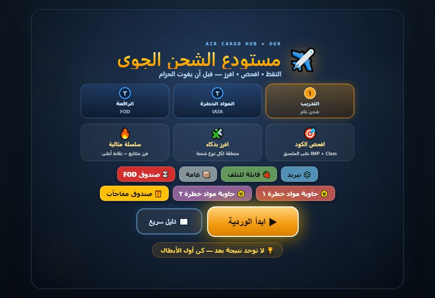
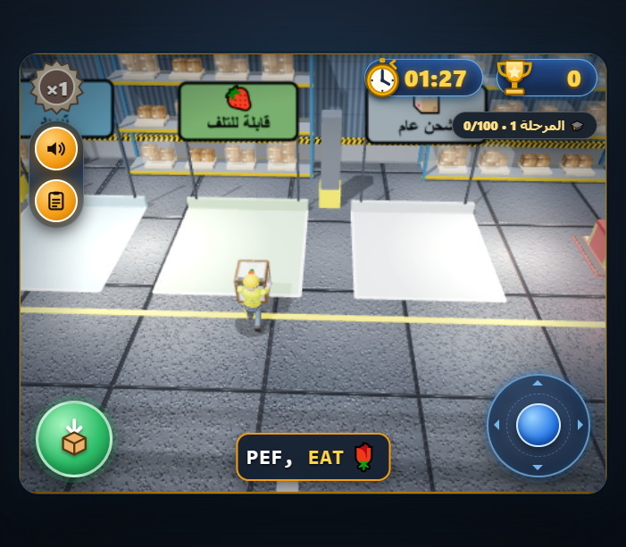

# مستودع الشحن الجوي الدولي (Inspector Box Ballet)

لعبة متصفح ثلاثية الأبعاد بالعربية لفرز الشحنات الجوية والمواد الخطرة وفق نموذج مبسّط من
IATA DGR Table 9.3.A. تعمل مباشرة في المتصفح دون خادم أو تسجيل.

**[العب الآن](https://khalidsaif912.github.io/inspector-box-ballet/)**



## طريقة اللعب

- التقط الطرود من الحزام وضعها في المنطقة المطابقة قبل انتهاء الوقت.
- راجع كود المناولة (IMP) ورقم الفئة (Class) عند التقاط أي مادة خطرة.
- وزّع المواد المتعارضة بين حاويتي المواد الخطرة لتجنّب مخالفة IATA.
- المفتش يغرّم الطرود المتروكة خارج المناطق، والرافعة الشوكية تعبر المستودع مرة واحدة وتُسقط جسماً غريباً (FOD) يمكن جمعه.
- صناديق المفاجآت تمنح وقتاً أو نقاطاً أو كومبو، وقد تعاقبك.
- السلسلة المثالية: كل فرز ناجح خلال المهلة يرفع نغمة السلسلة والكومبو، وكل 4 فرزات متتالية تمنح مكافأة وميضاً ذهبياً.
- حدث التدفق السريع في المرحلتين 2 و3 يطلق ثلاث شحنات متتابعة على الحزام.
- التقاط طرد قرب نهاية الحزام يمنح +25 نقطة (إنقاذ اللحظة الأخيرة).

**التحكم:** `WASD` أو الأسهم للحركة، و`Space` / `E` / `Enter` للالتقاط والإفلات.
على الجوال: عصا التحكم يميناً وزر الإجراء يساراً. زر الدليل يوقف اللعب مؤقتاً.

## المراحل والنقاط

| المرحلة | المحتوى                                                  |
| ------- | -------------------------------------------------------- |
| 1       | شحن عام وتبريد وقابل للتلف، مع تدريب على المفتش والرافعة |
| 2       | المواد الخطرة بفئاتها 1–9 والمفتش                        |
| 3       | الرافعة الشوكية وFOD                                     |

- الفرز الصحيح: +10 × الكومبو (حتى ×8)، ومضاعفة للمواد الخطرة، و+3 ثوانٍ.
- شحن منطقة كاملة: +40 نقطة و+15 ثانية.
- الخطأ: −10 نقاط و−2/−5 ثوانٍ. الطرد الفائت: −5/−10. مخالفة المفتش: −15 و−4 ثوانٍ.
- تبدأ الوردية بـ100 ثانية وتنتهي عند الصفر، وتُعرض الرتبة (S/A/B/C) والنجوم وملخص الدقة، مع حفظ أفضل نتيجة محلياً.

## البنية

- `public/game.html` — اللعبة كاملة (Three.js + واجهة عربية RTL).
- `public/game-rules.js` — قواعد الرافعة والفصل بين المواد الخطرة، مشتركة بين المتصفح والاختبارات.
- `public/vendor/three.min.js` — نسخة Three.js r128 محلية، دون اعتماد على CDN.
- `src/` — غلاف TanStack Start + React يعرض اللعبة داخل iframe.
- `docs/` — لقطات من اللعبة.



## التشغيل

يتطلب Node.js 22 أو أحدث.

```sh
npm install        # تثبيت الحزم
npm run dev        # تشغيل محلي على http://localhost:8080
npm run build      # بناء نسخة الإنتاج في .output/
npm run preview    # معاينة نسخة البناء
npm test           # اختبارات Vitest
npm run lint       # ESLint
npm run typecheck  # TypeScript
```

## النشر

- GitHub Pages: يعمل `.github/workflows/pages.yml` تلقائياً عند الدفع إلى `main` وينشر محتوى `public/`
  (اللعبة فقط) على الصفحة الرئيسية.
- تطبيق React: البناء الافتراضي يستهدف Cloudflare Workers. للنشر على منصة أخرى غيّر الهدف بمتغير
  البيئة `NITRO_PRESET`، مثل `NITRO_PRESET=netlify npm run build`.

## تنبيه

القواعد في اللعبة تبسيط تعليمي لجدول IATA DGR Table 9.3.A (2023)، وتستثني 1.4S والفئتين 6 و7 من
الفصل، وتطبّق تعارضات الفئة 9 على بطاريات الليثيوم فقط. هي لا تغني عن النسخة الرسمية من
IATA DGR أو دليل مشغّل الطائرة.

## الترخيص

MIT — انظر [LICENSE](LICENSE).
